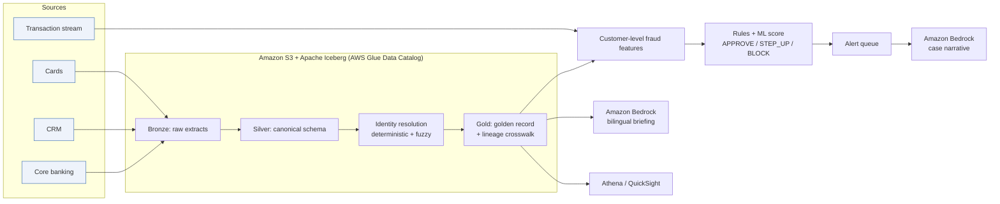

# Architecture

| Layer | Demo | Production |
|---|---|---|
| Ingestion | CSV extracts | AWS DMS (CDC), Amazon MSK / Kinesis, AppFlow |
| Storage | Iceberg tables via Athena | Iceberg on S3 / S3 Tables, Glue Data Catalog |
| Identity resolution | pandas (this repo) | AWS Glue / EMR Spark, or AWS Entity Resolution |
| Fraud scoring | numpy logistic regression + rules | SageMaker real-time endpoint, Managed Flink features |
| Governance | — | AWS Lake Formation (row/column security, masking) |
| GenAI | Amazon Bedrock Converse API | Bedrock with Guardrails |
